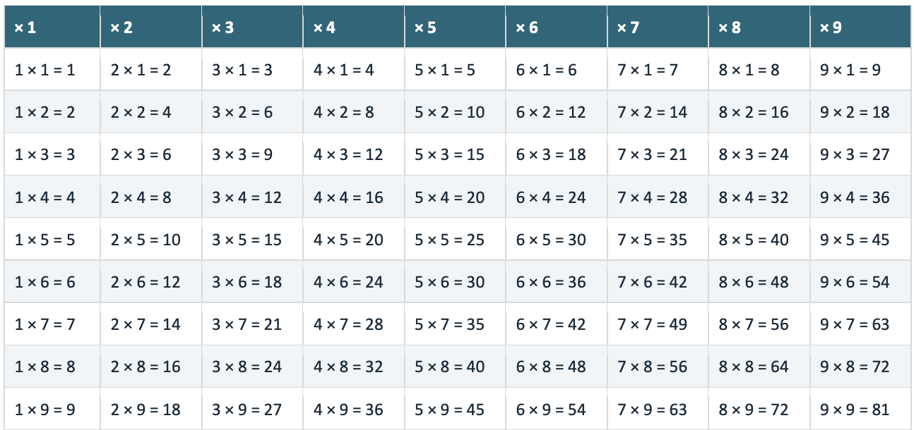
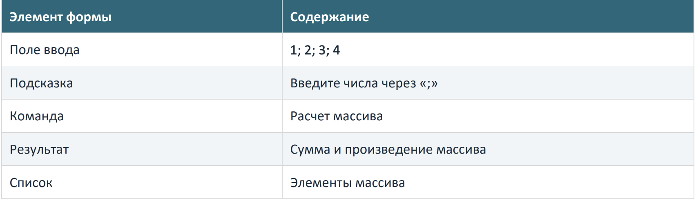
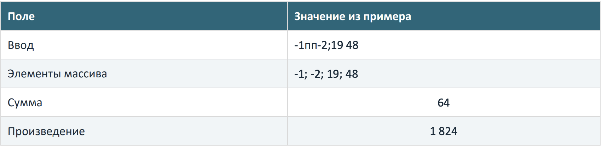

# Таблица умножения и обработка массива

Выполнить задачи во внешней обработке на разных страницах формы.

Таблица умножения Вывести таблицу умножения от 1 до 9.

* Числа в коде не прописывать. Исключение: числа для задания итератора цикла «По».
* Заполнить таблицу с помощью одного или двух циклов, без жестко заданных строк и колонок.
* Запретить изменение таблицы пользователем.
* Повторное нажатие команды вывода таблицы не должно изменять ее наполнение.

Пример таблицы из условия

### Сумма и произведение элементов массива

Заполнить массив чисел вводом с клавиатуры. Посчитать сумму и произведение элементов. Вывести массив, сумму и произведение. Учитывать отрицательные числа.

Пример формы ввода из условия

* Предусмотреть и корректно обработать ошибки пользовательского ввода. Не допускать непонятных сообщений и платформенных ошибок.
* Строка «-1пп-2;19 48» должна быть обработана и посчитана верно.
* Посимвольный перебор строки не допускается.

Пример обработки некорректного ввода из условия

### Пояснение к выполнению

Во внешней обработке создать макет и текстом описать ход рассуждений по каждому заданию. Сделать акцент на логике и объяснении принятых решений, а не на технических подробностях.
